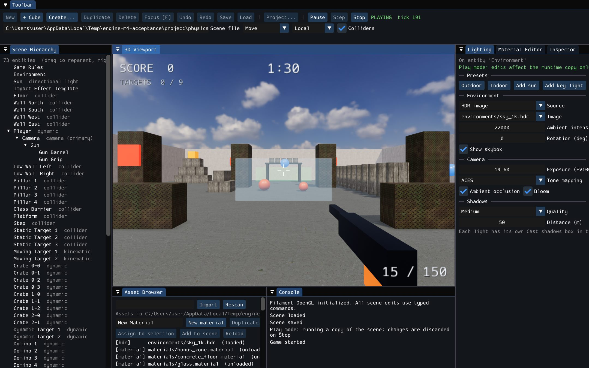
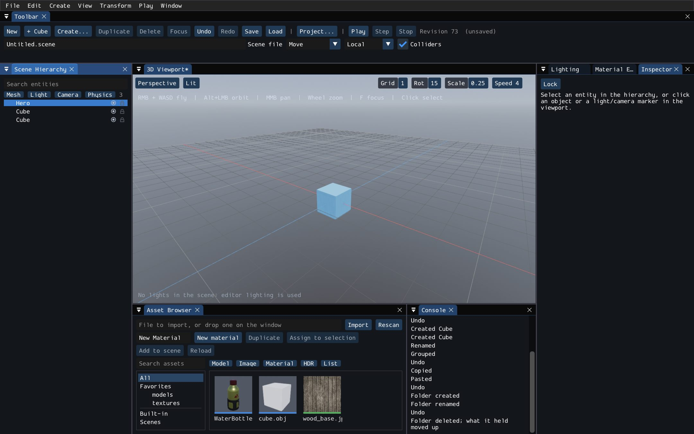

# IdlyEngine

A C++20 game engine with a 3D editor, built on Filament rendering, Box3D physics and Flecs. It ships with a playable sample game,
the **Physics Shooter**, made entirely from data on top of the engine's reusable systems.



**Status:** Windows x64 with MSVC is the built and tested platform. Linux GCC has a preset but is not verified. 409 CTest entries
pass, along with GPU smoke tests and scripted runs that use real mouse and keyboard input. Hosted CI is set up in
`.github/workflows/ci.yml` and runs for the first time with this repository.

## Contents

- [What's in it](#whats-in-it)
- [Build it](#build-it)
- [Run the editor](#run-the-editor)
- [Use the editor](#use-the-editor)
- [Play the sample](#play-the-sample)
- [Test it](#test-it)
- [How it was built](#how-it-was-built)
- [Known limits](#known-limits)
- [Documentation](#documentation)

## What's in it

| Module | Path | What it does |
|---|---|---|
| Core | `Engine/Core` | Application loop, `Result` type, diagnostics |
| ECS | `Engine/ECS` | Entity world on Flecs |
| Scene | `Engine/Scene` | Entities and components, hierarchy, a versioned text scene format (versions 1 to 5 load) |
| Commands | `Engine/Commands` | `CommandBus`: every scene edit is a typed command, with named undo steps and transactions |
| Renderer | `Engine/Renderer` | Filament renderer: PBR materials, directional, spot and point lights, shadows, image-based lighting, skybox, tone mapping, bloom, ambient occlusion, thumbnails, and the ImGui renderer |
| Physics | `Engine/Physics` | Box3D rigid bodies, colliders, raycasts, impulses, contact, hit and sensor events, and the bridge that keeps scene and physics in step |
| Assets | `Engine/Assets` | Asset database with stable IDs and `.meta` files. Importers for `.glb`, `.obj`, `.png`, `.jpg`, `.tga`, `.ppm` and `.hdr`, run in the background |
| Gameplay | `Engine/Gameplay` | Input actions, first-person movement, weapons, damage, targets, score, pickups, win and loss rules |
| Networking | `Engine/Networking` | Serialization, connection manager and a loopback transport. The GameNetworkingSockets backend is compile-checked only (see [Known limits](#known-limits)) |
| Online services | `Engine/OnlineServices` | Online service interface and a null implementation |
| Editor | `Engine/Editor` | The 3D editor (`engine_editor`), described below |

### The editor



The editor's controls are modelled on Unreal Engine's:

- **Commands everywhere.** Every action is a named command. Menus, toolbar buttons, tooltips and the shortcut list are all built from
  one registry, and every key can be rebound in **Window > Keyboard Shortcuts**.
- **Everything can be undone.** One ordered history covers the scene, folders and materials. A drag is a single step, and
  **Window > Undo History** jumps to any step.
- **Viewport.** Fly with the right mouse button and `W` `A` `S` `D`, orbit with Alt, pan, dolly and zoom. There are perspective and
  orthographic views, lit, unlit and wireframe modes, a game view and camera bookmarks.
- **Gizmos.** Move, rotate and scale in world or local axes. Snap to the grid, the floor or a vertex. Alt+drag makes a copy. You can
  type exact amounts mid-drag, such as `x3` or `y90`.
- **Panels.** The Details panel (labelled Inspector) is generated from property metadata, and editing several objects at once shows
  differing values as "Multiple Values". The Outliner (labelled Scene Hierarchy) has folders, lock, hide and filters. The Asset
  Browser has thumbnails, rename and move with references kept. There is also a Material Editor, a Lighting panel, a drawer and named
  layouts.
- **Workflow.** Play, simulate, leave the player and take it back. There is a command palette (`Ctrl+Shift+P`), quick open (`Ctrl+P`)
  and a console with console variables and suggestions.
- **Feedback.** Notices pop up in the corner, and a Message Log can be filtered by severity, with links to the objects and assets
  named. Background tasks show progress and can be cancelled. Hold `F1` for a cheat sheet of the keys that work where the mouse is.

## Build it

### Requirements

- Windows 10 or 11, x64
- Visual Studio 2022 with **Desktop development with C++** (tested with MSVC 14.44 and Windows SDK 10.0.26100)
- CMake 3.25 or later, and Ninja
- Python 3, to fetch the dependencies
- Several GB of free disk space and a long first build, because Filament is built from source

### 1. Fetch the third-party sources

The dependencies are not in this repository. They are checked out at the commits pinned in
[`cmake/DependencyLock.cmake`](cmake/DependencyLock.cmake), into a folder of your choice:

```powershell
python -I cmake/scripts/fetch_dependencies.py D:\deps\idly box3d GameNetworkingSockets flecs glm spdlog glfw imgui filament
$env:GAMEENGINE_RESOURCES_DIR = 'D:\deps\idly'
```

If `GAMEENGINE_RESOURCES_DIR` is not set, the build looks for `resources/` inside the repository, which `.gitignore` excludes.
Nothing is ever written into this folder. Keep it on the **same drive** as the build folder, because Filament needs relative paths
between them.

| Dependency | License | Used for |
|---|---|---|
| Filament | Apache-2.0 | Rendering |
| Box3D | MIT | Physics |
| Flecs | MIT | ECS |
| GLFW | zlib | Windows and input |
| Dear ImGui (docking) | MIT | Editor UI |
| GLM | MIT | Math |
| spdlog | MIT | Logging |
| GameNetworkingSockets | BSD-style | Networking backend, headers only for now |

The full list, with commits, is in [`docs/build/dependencies.md`](docs/build/dependencies.md).

### 2. Configure, build and test

From a **Developer PowerShell for VS 2022**, run the commands directly. From any other PowerShell, prefix them with
`cmake/scripts/dev-shell.ps1`, which loads the MSVC environment:

```powershell
./cmake/scripts/dev-shell.ps1 cmake --preset windows-msvc-release
./cmake/scripts/dev-shell.ps1 cmake --build --preset windows-msvc-release
./cmake/scripts/dev-shell.ps1 ctest --preset windows-msvc-release
```

| Preset | Build type | Notes |
|---|---|---|
| `windows-msvc-debug` | Debug | Box3D asserts on |
| `windows-msvc-release` | Release | Use this one to run the editor and the sample |
| `windows-msvc-ci` | RelWithDebInfo | Warnings are errors on engine targets, and dependencies must be at their pinned commits |
| `linux-gcc-debug` | Debug | Authored, not verified. The editor is off |

| Option | Default | Meaning |
|---|---|---|
| `GAMEENGINE_BUILD_EDITOR` | ON | Build GLFW, ImGui, Filament and the editor |
| `GAMEENGINE_WITH_PHYSICS` | ON | Build Box3D and the physics module |
| `GAMEENGINE_BUILD_TESTS` | ON | Build the tests and register them with CTest |
| `GAMEENGINE_WARNINGS_AS_ERRORS` | OFF | Treat warnings as errors on engine targets only |
| `GAMEENGINE_WITH_GNS` | OFF | Build GameNetworkingSockets. Needs protobuf |

Build troubleshooting, including what to do when `vcvars64.bat` hangs and the Filament-specific rules, is in
[`docs/build/building.md`](docs/build/building.md).

## Run the editor

The editor is written to `build\<preset>\bin`. Run it from there, because it finds its compiled materials in the build folder.

```powershell
build\windows-msvc-release\bin\engine_editor.exe --sample
```

| Option | What it does |
|---|---|
| (none) | Opens an untitled scene with one cube, and uses the current folder as the project |
| `--sample` | Opens the Physics Shooter sample |
| `--project <folder>` | Uses this folder as the project |
| `--scene <file>` | Loads this scene at the start |
| `--config-dir <folder>` | Keeps settings here instead of `%APPDATA%\GameEngine\` |
| `--smoke` | GPU smoke test: opens a window for a few seconds and checks what was drawn |
| `--render-test <folder>` | Pixel tests for materials, lights and shadows, with captures saved to the folder |

## Use the editor

### Your first scene

1. **Project... > New Empty Project...** in the toolbar. Type a folder path and press Enter. This creates the folder, an `Assets`
   folder and `main.scene`.
2. **Create...** a **Floor**, then a **Cube**.
3. With the mouse over the viewport, press `W` and drag the red arrow.
4. **Create...** a **Falling Sphere**. It appears 3 m above the floor.
5. `Ctrl+S` saves.
6. `Alt+S` simulates, and the sphere falls onto the floor. `Esc` stops, and everything goes back to where it was.

A plain Cube has no collider. To make something solid, use **Falling Cube** or **Floor**, or add a collider with **Add Component**.

### The keys you'll use most

| Keys | Action |
|---|---|
| RMB + `W` `A` `S` `D` / `Q` `E` | Fly / down, up |
| Alt + LMB, Alt + RMB, MMB | Orbit, dolly, pan |
| Wheel / `F` | Zoom / frame the selection |
| `W` / `E` / `R` / `Space` | Move / rotate / scale gizmo / the next one |
| `` Ctrl+` `` | World or local axes |
| Type during a gizmo drag | An exact amount, such as `x3`, `z-1.5`, `y90` |
| `Ctrl+Z` / `Ctrl+Y` | Undo / redo |
| `Ctrl+D`, `Ctrl+C`, `Ctrl+V`, `Delete` | Duplicate, copy, paste, delete |
| `F2` / `Ctrl+G` / `H` / `End` | Rename / group / hide / drop onto the surface below |
| `Alt+G` `Alt+H` `Alt+J` `Alt+K` | Perspective, front, top, side |
| `Alt+P` / `Alt+S` / `F8` / `Esc` | Play / simulate / leave or rejoin the player / pause, then stop |
| `Ctrl+Shift+P` / `Ctrl+P` / `` ` `` | Command palette / quick open / console |
| Hold `F1` | Cheat sheet of the keys that work here |

Every shortcut is in [`docs/EDITOR_SHORTCUTS.md`](docs/EDITOR_SHORTCUTS.md), which is generated from the command registry. The full
walkthrough, covering assets, materials, lighting, the console and where your files are kept, is in
[`docs/EDITOR_GUIDE.md`](docs/EDITOR_GUIDE.md).

### Assets

Drop a file on the window, or type its path in the Asset Browser. Supported formats are `.glb`, `.obj`, `.png`, `.jpg`, `.tga`, `.ppm`
and `.hdr`, up to 64 MB. Imported files are copied into the project's `Assets` folder, each with a `.meta` file that keeps its ID
stable. Drag a model into the viewport to place it. **New material** creates a material, which you edit in the Material Editor.

### Where things are kept

| What | Where |
|---|---|
| A scene | The `.scene` file named in the toolbar |
| Assets and materials | `Assets\` in the project folder |
| Hidden objects and camera bookmarks | `<scene>.editor`, beside the scene |
| Keys, layout and settings | `keymap.ini`, `layout.ini` and `editor.ini` in `%APPDATA%\GameEngine\` |

## Play the sample

Open **Project... > Open Physics Shooter Sample**, or start the editor with `--sample`. Press **Play**, then click the view. You have
90 seconds to destroy all 9 targets.

| Input | Action |
|---|---|
| `W` `A` `S` `D` / mouse | Move / look |
| LMB | Fire |
| `Space` / `Shift` | Jump / sprint |
| `R` | Reload, or restart once the game has ended |
| `Esc` | Free the mouse and pause. Press it again to stop |

Shots push what they hit. Crates topple, a row of dominoes can knock over the last target, glass breaks, and a crate that lands in the
green zone scores points. Static targets stay put, kinematic ones follow a path, and dynamic ones can also be destroyed by a hard fall.
**Stop** puts the scene back exactly as it was.

Everything specific to the shooter is data in [`Samples/PhysicsShooter`](Samples/PhysicsShooter): the scenes, materials and a
generator script. Its textures, HDR sky and model are CC0, listed in
[`ASSET_LICENSES.md`](Samples/PhysicsShooter/ASSET_LICENSES.md). The sample opens from the source tree, so to experiment, copy the
folder and open the copy with `--project <copy> --scene <copy>\physics_shooter.scene`.

## Test it

```powershell
./cmake/scripts/dev-shell.ps1 ctest --preset windows-msvc-debug              # everything
./cmake/scripts/dev-shell.ps1 ctest --preset windows-msvc-debug -L physics   # one label
./cmake/scripts/dev-shell.ps1 ctest --preset windows-msvc-debug -L smoke     # headless smoke tests
```

There are **409 CTest entries**, covering physics, the scene bridge, gameplay, assets, networking, online services, the core, the
renderer snapshot and the editor. The editor tests run without a window: the commands, the viewport camera, the panels, the workflow
and the feedback. Each test case runs in its own process. The test framework in `Tests/Framework` has no third-party dependencies.

**Real-input tests** in `Tests/RealInput` drive a Release editor with real mouse and keyboard input. They cover the Milestone 3
workflow, the shooter from start to win and loss, and each phase of the editor UX work:

```powershell
powershell -ExecutionPolicy Bypass -File Tests/RealInput/editor_ux_phase5.ps1 -Editor <engine_editor.exe> -Output <folder>
```

They wait for the desktop to be idle and stop if the editor loses focus, so don't use the PC while they run. A run that stops exits
with code 2 and proves nothing either way.

Details are in [`docs/testing/README.md`](docs/testing/README.md). Results and screenshots from every milestone and phase are in
[`docs/evidence`](docs/evidence).

## How it was built

The engine was built in milestones. Each one has a plan, a report and saved evidence.

| Stage | What it delivered | Docs |
|---|---|---|
| Milestone 1 | Core, ECS, scene, commands, render snapshot, physics, networking and online-service interfaces, the build system and the test framework | `docs/architecture/001` to `004` |
| Milestone 2 | Integration of the parallel work: a first editor, the asset pipeline, and a repair and audit pass | [`MILESTONE_2_INTEGRATION_AUDIT.md`](docs/MILESTONE_2_INTEGRATION_AUDIT.md), `docs/integration/` |
| Milestone 3 | A working 3D editor: hierarchy, inspector, gizmos, Play mode with physics, assets, a scene format, DPI scaling. 146 tests | [`MILESTONE_3_REPORT.md`](docs/MILESTONE_3_REPORT.md) |
| Milestone 4 | PBR materials, lighting, shadows, IBL, a Material Editor, gameplay systems and the Physics Shooter sample. 207 tests | [`MILESTONE_4_REPORT.md`](docs/MILESTONE_4_REPORT.md) |
| Editor UX, phases 1 to 5 | The Unreal-style editor: command registry, rebinding, undo history, viewport feel, generated panels, Play, Simulate and Eject, palette and console, toasts, log and background tasks. 409 tests | [`EDITOR_UX_PLAN.md`](docs/EDITOR_UX_PLAN.md) |

Design notes are in [`docs/architecture`](docs/architecture). For example, `006-scene-format.md` describes the scene file, and
`008-editor-ux.md` explains how to add a command or an inspectable property.

## Known limits

- **Windows only so far.** The Linux preset is not verified, and there are no mobile or console builds.
- **No multiplayer yet.** GameNetworkingSockets needs protobuf, which isn't provided yet, so only the loopback transport works.
- **Panels can't be dragged out into separate OS windows.** They float inside the main window. Separate windows are the next planned
  editor feature.
- **The editor isn't relocatable.** It loads its compiled materials from the build folder.
- **Some work still runs on the main thread:** saving and loading a scene, adding a finished import, and reading material thumbnails.
  The import progress bar shows that an import is running, not how far along it is.
- **Large scenes are slow to edit.** One drag step takes about 32 ms in a 10,000-entity scene.
- **Imported models have no animation.** Skinned models come in their bind pose. `.gltf` files must be re-exported as `.glb`.
- **Mouse gestures can't be rebound yet,** only keys.
- **The sample was played by a script, not tested by people.** Its controls and rules work, but its feel and difficulty haven't had
  human playtesting.

Each milestone report and plan phase lists what was not verified, in full.

## Documentation

| Document | Contents |
|---|---|
| [`docs/EDITOR_GUIDE.md`](docs/EDITOR_GUIDE.md) | How to use the editor |
| [`docs/EDITOR_SHORTCUTS.md`](docs/EDITOR_SHORTCUTS.md) | Every command and its keys |
| [`docs/build/building.md`](docs/build/building.md) | Building, presets, options, troubleshooting |
| [`docs/build/dependencies.md`](docs/build/dependencies.md) | Third-party audit, pinned commits, licenses |
| [`docs/testing/README.md`](docs/testing/README.md) | Test suites, labels, the framework, real-input runs |
| [`docs/architecture/`](docs/architecture) | Design notes for each module and milestone |
| [`Samples/PhysicsShooter/README.md`](Samples/PhysicsShooter/README.md) | The sample game |

## License

No license has been chosen for the engine's own code yet. Third-party dependencies and sample assets keep their own licenses, listed
above.
